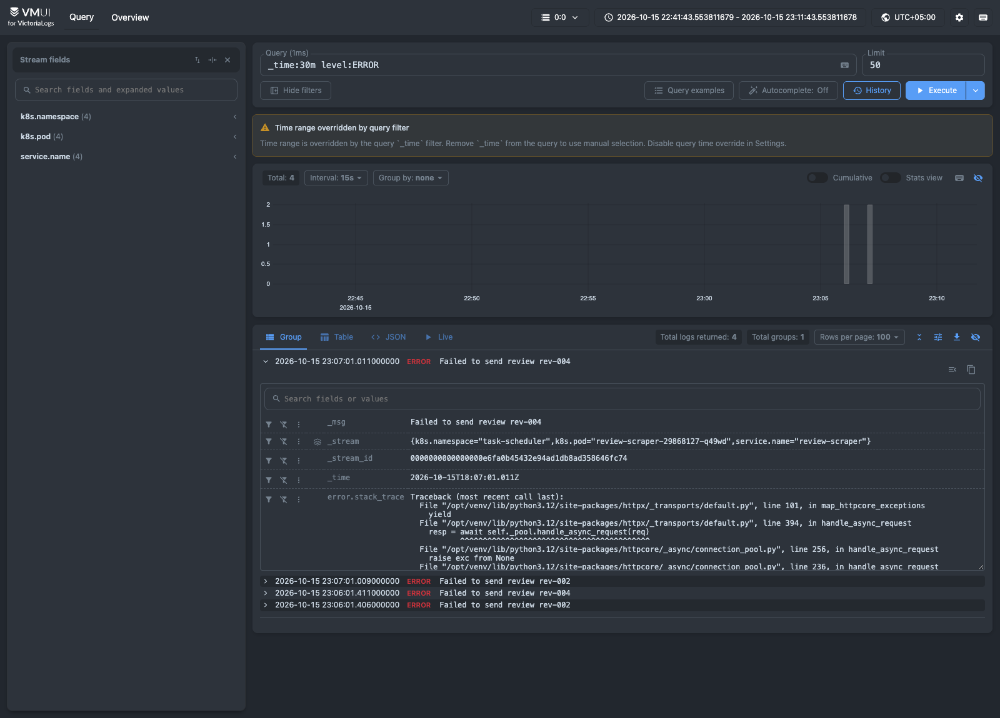
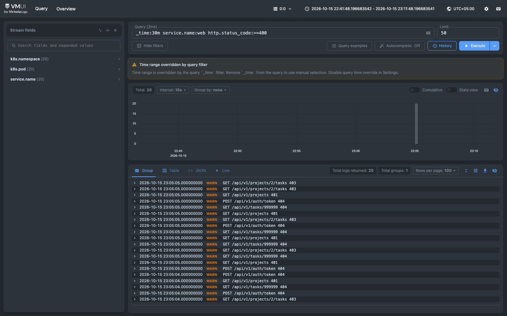
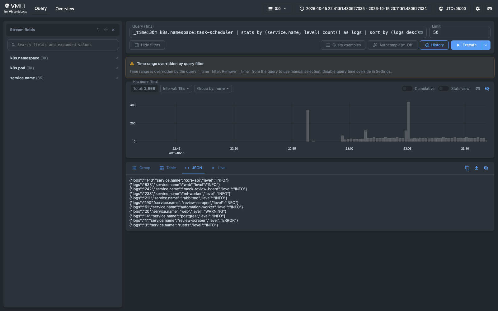
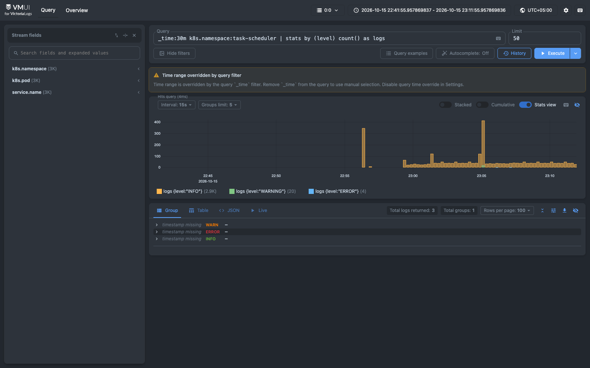
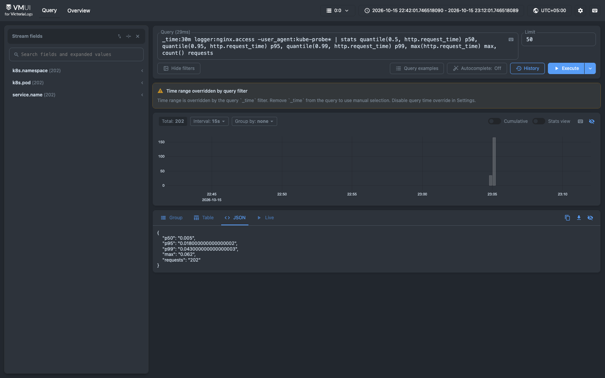
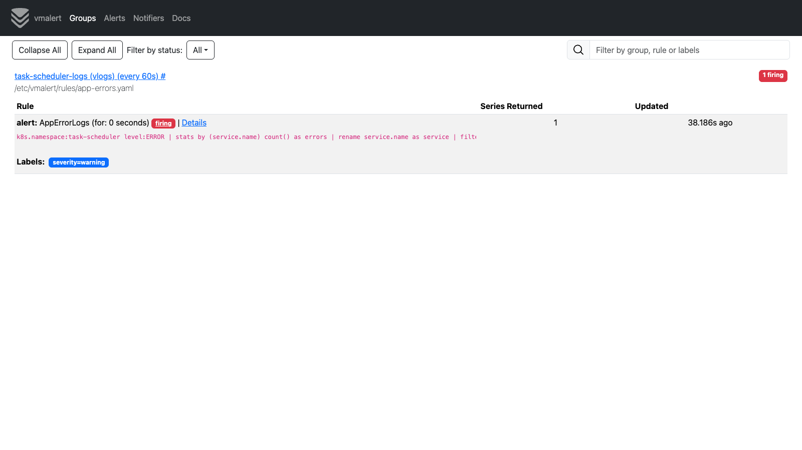

# Логи Victory Group Task Scheduler в VictoriaLogs

Приложение из ДЗ №1 работает в minikube (namespace `task-scheduler`). В тот же кластер, в namespace `logging`, развёрнуты VictoriaLogs (single-node) и агент Vector, который доставляет в неё логи подов приложения. Бонус — алерт через vmalert.

## Состав и запуск

| Файл | Что внутри |
|---|---|
| `k8s/logging/10-victorialogs.yaml` | VictoriaLogs v1.53.0: StatefulSet + PVC + Service `victorialogs:9428` |
| `k8s/logging/20-vector.yaml` | Vector 0.58.0: DaemonSet, конфиг в ConfigMap, RBAC на чтение метаданных подов |
| `k8s/logging/30-vmalert.yaml` | vmalert v1.153.0 с правилом по LogsQL |
| `k8s/logging/demo-load.sh` | трафик, ошибки 4xx и учебный инцидент |
| `services/…`, `jobs/…`, `apps/web/nginx/…` | JSON-логирование сервисов и nginx |

```bash
kubectl apply -f k8s/logging/
kubectl -n logging port-forward svc/victorialogs 9428:9428   # vmui: http://localhost:9428/select/vmui/
./k8s/logging/demo-load.sh
```

## 1. Формат логов

Python-сервисы уже писали JSON в stdout, но имена полей не совпадали с чек-листом, а mock-review-board и nginx писали текст. Теперь все шесть сервисов пишут одну схему:

| Поле | Пример | Назначение |
|---|---|---|
| `timestamp` | `2026-10-15T18:07:01.011+00:00` | время события → `_time` |
| `level` | `INFO` / `WARNING` / `ERROR` | важность |
| `message` | `Failed to send review rev-004` | текст → `_msg` |
| `service.name`, `service.version` | `review-scraper`, `dev` | сервис и версия релиза |
| `logger` | `uvicorn.access`, `nginx.access` | источник внутри процесса |
| `http.method`, `url.path`, `http.status_code` | `GET`, `/api/v1/projects`, `200` | у access-логов |
| `http.request_time` | `0.018` | у nginx, секунды числом — для квантилей |
| `error.stack_trace` | трейсбек | у ошибок с исключением |

У nginx уровень зависит от кода ответа: 5xx → ERROR, 4xx → WARNING. Vector добавляет к каждой записи `k8s.namespace`, `k8s.pod`, `k8s.container`, `k8s.node`.

## 2. Доставка: Vector как DaemonSet

```
под ──stdout──► /var/log/pods/…/0.log ──► Vector (DaemonSet) ──ES bulk──► VictoriaLogs ◄── vmui, vmalert
```

Почему так:
- **Агент, а не отправка из кода.** Приложение не знает адрес хранилища логов и просто пишет в stdout (XI фактор). Агент читает файлы, которые kubelet уже записал на диск, поэтому даже вывод упавшего контейнера не теряется.
- **DaemonSet, а не сайдкар.** Один агент на ноду вместо лишнего контейнера в каждой реплике. Манифесты сервисов не меняются, новые поды и запуски CronJob подхватываются сами.
- **Vector.** Источник `kubernetes_logs` сразу добавляет метаданные пода, разбор пишется на VRL, конфиг проверяется командой `vector validate`. OTel Collector был бы оправдан, если бы кроме логов собирались трейсы и метрики.
- **Протокол Elasticsearch bulk.** Это родной sink Vector, и VictoriaLogs его поддерживает. Параметры запроса задают `_msg_field=message`, `_time_field=timestamp` и поля потока `k8s.namespace,service.name,k8s.pod`.

JSON-строка становится событием целиком. У текстовых строк (nginx error log, Postgres, RabbitMQ) уровень берётся из тега `[warn]` или `ERROR:`. Собирается только namespace `task-scheduler`.

При настройке пришлось учесть две вещи. В minikube файлы в `/var/log/pods` — ссылки в `/var/lib/docker/containers`, поэтому смонтированы обе директории. И по умолчанию Vector ищет новые файлы раз в 60 секунд, задано 5 секунд.

## 3. LogsQL-запросы

Данные создал `demo-load.sh`: обычная работа двух пользователей, ошибки клиента (401/403/404) и инцидент — ml-worker опущен до 0 реплик на 2 минуты, и запуски скрейпера в это время пишут ERROR.

### (а) Сырые записи за 15 минут

```
_time:15m k8s.namespace:task-scheduler
```

Все записи приложения, новые сверху, плюс гистограмма по времени. Одна запись раскрыта: видны поля приложения и метаданные `k8s.*`. Больше всего здесь probe-запросов kubelet к `/health` и `/ready`.


### (б) Фильтр по полю

```
_time:30m level:ERROR
```

4 ошибки `review-scraper` за время инцидента. В `error.stack_trace` видна причина: `httpx.ConnectError` — у Service `ml-worker` не было подов.



Фильтр по числовому полю: `_time:30m service.name:web http.status_code:>=400` находит 20 ответов 401/403/404.



### (в) stats с группировкой

```
_time:30m k8s.namespace:task-scheduler | stats by (service.name, level) count() as logs | sort by (logs desc)
```

Сколько записей каждого уровня написал каждый сервис. Больше всего пишут core-api и web, а из не-INFO выделяются `web WARNING` (20) и `review-scraper ERROR` (4).



Тот же подсчёт `stats by (level)` в режиме «Stats view» показывает, когда появлялись WARNING и ERROR.



### (г) Агрегации

```
_time:30m logger:nginx.access -user_agent:kube-probe*
  | stats quantile(0.5, http.request_time) p50, quantile(0.95, http.request_time) p95,
          quantile(0.99, http.request_time) p99, max(http.request_time) max, count() requests
```

Время ответа по 202 пользовательским запросам: p50 5 мс, p95 18 мс, p99 43 мс.



`... | top 5 by (url.path)` — самые частые пути API: колонки и задачи доски, список проектов.


`... | stats by (service.name) count_uniq(k8s.pod)` — подов на сервис: 13 у review-scraper (CronJob раз в минуту), 4 у core-api и 3 у web (реплики после `scale`), 2 у ml-worker (до и после инцидента).


## 4. Бонус: vmalert

vmalert раз в минуту выполняет запрос и поднимает алерт, если за минуту есть ERROR:

```yaml
- alert: AppErrorLogs
  expr: k8s.namespace:task-scheduler level:ERROR | stats by (service.name) count() as errors | rename service.name as service | filter errors:>0
```

Alertmanager нет (`-notifier.blackhole`), алерты видны в UI vmalert. На скриншоте — повторный инцидент: `AppErrorLogs` в состоянии `firing` для `review-scraper`.



