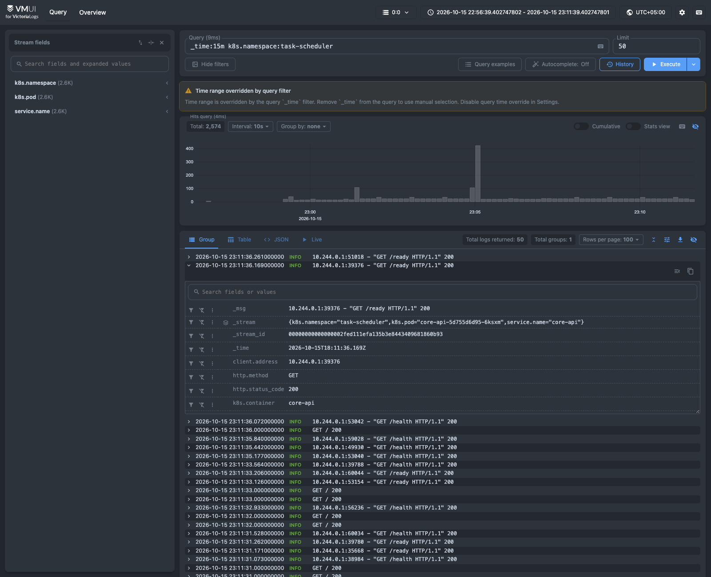
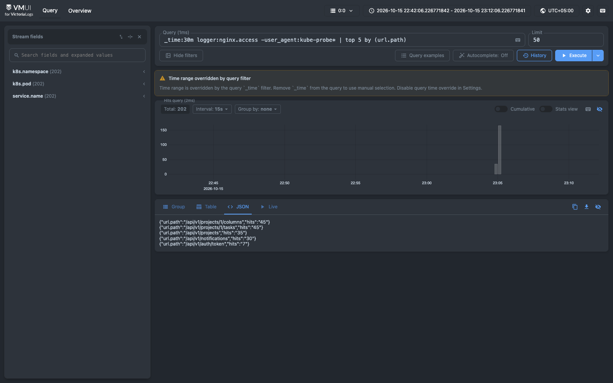
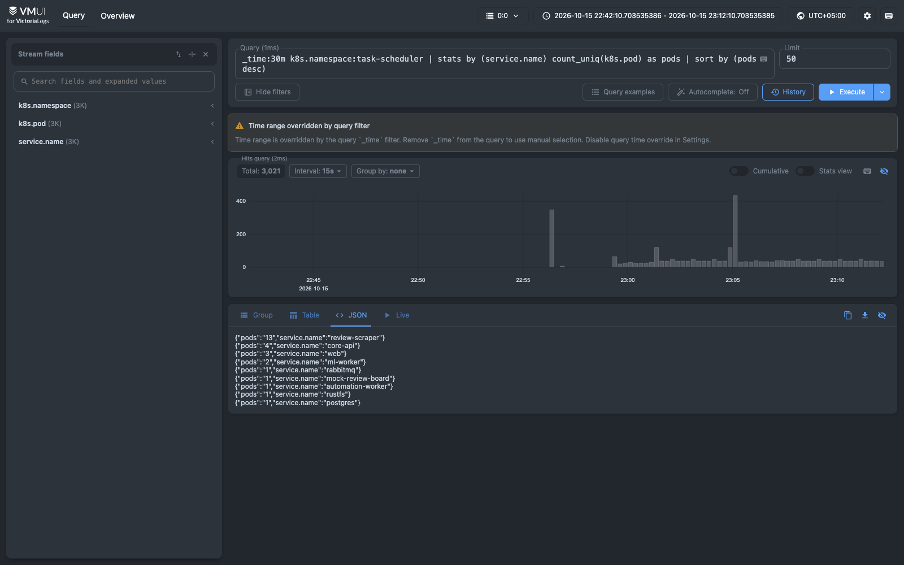
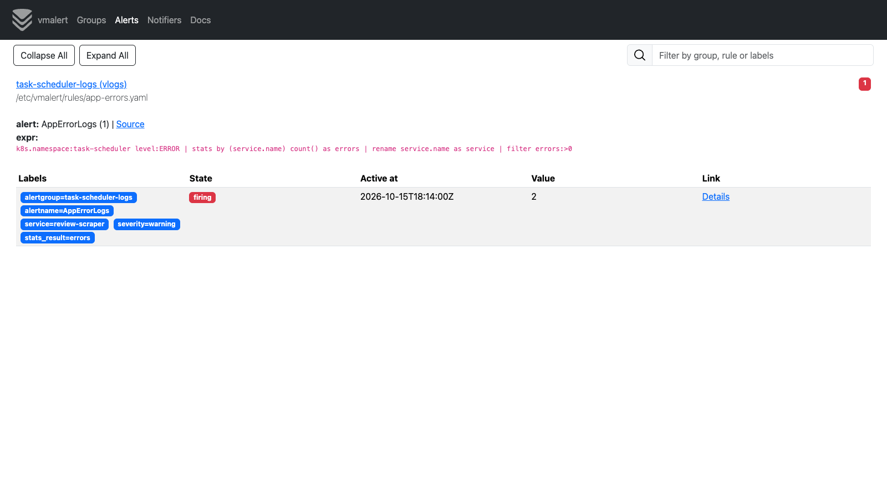

# Логи Victory Group Task Scheduler в VictoriaLogs

Продолжение ДЗ №1: приложение уже работает в minikube (namespace `task-scheduler`). В тот же кластер развёрнуты VictoriaLogs (single-node) и агент Vector. Vector собирает логи всех подов приложения и отправляет их в VictoriaLogs. Дальше логи ищутся и агрегируются LogsQL-запросами в vmui. В качестве бонуса vmalert поднимает алерт по одному из этих запросов.

## Состав

| Файл | Что внутри |
|---|---|
| `k8s/logging/00-namespace.yaml` | Namespace `logging`, отдельный от приложения |
| `k8s/logging/10-victorialogs.yaml` | VictoriaLogs v1.53.0: StatefulSet + PVC 2Gi + Service `victorialogs:9428` |
| `k8s/logging/20-vector.yaml` | Vector 0.58.0: DaemonSet + ConfigMap с конфигом + ServiceAccount/ClusterRole для чтения метаданных подов |
| `k8s/logging/30-vmalert.yaml` | Бонус: vmalert v1.153.0 с правилом по LogsQL-запросу |
| `k8s/logging/demo-load.sh` | Скрипт, который создаёт трафик и учебный «инцидент», чтобы было что искать |
| `k8s/logging/screenshots/` | Скриншоты vmui и vmalert |
| `k8s/logging/pack.sh` | Сборка этого архива (в репозитории) |
| `services/*/…logging_config.py`, `services/automation-worker/main.py`, `jobs/review-scraper/scraper.py`, `services/mock-review-board/app/main.py` | JSON-логирование Python-сервисов |
| `apps/web/nginx/default.conf.template` | JSON access-лог nginx |

## Запуск

```bash
minikube start                                   # кластер из ДЗ №1, приложение уже развёрнуто
./k8s/build-images.sh                            # пересобрать образы с новым форматом логов
kubectl rollout restart deploy -n task-scheduler

kubectl apply -f k8s/logging/
kubectl get pods -n logging                      # victorialogs-0, vector-xxxxx, vmalert-…

kubectl -n logging port-forward svc/victorialogs 9428:9428
# vmui: http://localhost:9428/select/vmui/

./k8s/logging/demo-load.sh                       # трафик + 4xx + 2-минутный инцидент
```

## 1. Формат логов приложения

Python-сервисы уже писали JSON в stdout (это было сделано в работе про 12 факторов), но имена полей не совпадали с чек-листом семинара. Кроме того, два компонента писали текст:

| Было | Стало |
|---|---|
| `ts`, `service` | `timestamp`, `service.name` |
| — | `service.version` — тег образа (`APP_VERSION`), видно, какой релиз написал строку |
| access-лог uvicorn: только строка `"GET /ready HTTP/1.1" 200` | плюс поля `http.method`, `url.path`, `http.status_code`, `client.address` |
| `exc_info` | `error.stack_trace` |
| mock-review-board: текстовый лог uvicorn | JSON по той же схеме |
| web (nginx): текстовый access-лог `combined` | JSON: `level` зависит от кода ответа (5xx → ERROR, 4xx → WARNING), длительность запроса в числовом поле `http.request_time` |

Набор полей для всех шести сервисов:

| Поле | Пример | Зачем |
|---|---|---|
| `timestamp` | `2026-10-15T18:07:01.011+00:00` | время события в приложении → `_time` в VictoriaLogs |
| `level` | `INFO` / `WARNING` / `ERROR` | фильтр по важности, алерт |
| `message` | `Failed to send review rev-004` | текст события → `_msg` |
| `service.name` | `review-scraper` | какой сервис; поле потока (stream field) |
| `service.version` | `dev` | версия релиза |
| `logger` | `uvicorn.access`, `nginx.access`, `__main__` | источник внутри процесса |
| `http.*`, `url.path`, `client.address` | `GET`, `/api/v1/projects`, `200` | только у access-логов |
| `error.stack_trace` | трейсбек | только у ошибок с исключением |

Пример строки, которую core-api пишет в stdout:

```json
{"timestamp": "2026-10-15T18:09:20.413+00:00", "level": "INFO", "message": "10.244.0.1:39376 - \"GET /ready HTTP/1.1\" 200", "service.name": "core-api", "service.version": "dev", "logger": "uvicorn.access", "http.method": "GET", "url.path": "/ready", "http.status_code": 200, "client.address": "10.244.0.1:39376"}
```

Ключи плоские, с точками: VictoriaLogs индексирует такое поле сразу под этим именем. Запись в файлы, ротация и знание об адресе хранилища логов в приложении не появились. Оно, как и раньше, пишет поток событий в stdout.

К каждой записи Vector добавляет метаданные Kubernetes: `k8s.namespace`, `k8s.pod`, `k8s.container`, `k8s.node`, `stream`.

## 2. Доставка логов: Vector как DaemonSet

```
 под приложения ──stdout──► kubelet / Docker ──► /var/log/pods/<ns>_<pod>_<uid>/<container>/0.log
                                                          │ (одна копия Vector на ноду)
                                                          ▼
                                    Vector DaemonSet: kubernetes_logs → remap (VRL) → elasticsearch sink
                                                          │  POST /insert/elasticsearch/_bulk (gzip, батчи)
                                                          ▼
                                    VictoriaLogs (StatefulSet, PVC) ◄── vmui / LogsQL API / vmalert
```

**Почему именно так.** Варианты и выбор:

- **Агент на ноде, а не код в приложении.** Если отправлять логи прямо из приложения, оно должно знать адрес и протокол хранилища логов. Это противоречит XI фактору (логи — поток в stdout, маршрутизация — задача окружения). Кроме того, при падении процесса последние строки, которые он не успел отправить, теряются. Агент читает файлы, которые kubelet уже записал на диск. Поэтому даже вывод упавшего контейнера (`CrashLoopBackOff`, трейсбек до настройки логгера) попадает в хранилище.
- **DaemonSet, а не сайдкар.** Сайдкар — это ещё один контейнер в каждом поде, его надо прописывать в 6 манифестов и платить за него ресурсами каждой реплики. При `kubectl scale core-api --replicas=4` сайдкаров тоже стало бы четыре. DaemonSet — один агент на ноду, сервисы о нём не знают, новые поды и запуски CronJob подхватываются автоматически.
- **Vector, а не Fluent Bit или OpenTelemetry Collector.** Все три умеют тейлить `/var/log/pods`. У Vector источник `kubernetes_logs` сразу обогащает строку метаданными пода из API Kubernetes. Разбор пишется на VRL, а не цепочкой фильтров, и конфиг проверяется заранее командой `vector validate`. OTel Collector оправдан, когда кроме логов собираются трейсы и метрики. Здесь только логи.
- **Протокол — Elasticsearch bulk.** Это родной sink Vector, и VictoriaLogs его поддерживает. Параметры запроса говорят VictoriaLogs, какое поле считать сообщением (`_msg_field=message`), какое временем (`_time_field=timestamp`) и из каких полей собирать поток (`_stream_fields=k8s.namespace,service.name,k8s.pod`). Поток — это записи одного пода одного сервиса: они хранятся вместе и ищутся быстрее.

Что делает трансформация `remap` (`20-vector.yaml`):
1. Если строка — JSON-объект, это и есть событие со всеми полями приложения.
2. Если строка — текст (лог ошибок nginx, Postgres, RabbitMQ), текст сохраняется в `message`. Уровень берётся из тега `[warn]`/`[error]` или `ERROR:`/`FATAL:`, без тега — `INFO`.
3. Если у события нет `timestamp`, берётся время, когда Vector прочитал строку. Если нет `service.name`, подставляется имя контейнера.
4. Добавляются `k8s.*` и `stream`.

Собирается только namespace `task-scheduler` (`extra_field_selector`), собственные логи стека логирования в хранилище не попадают.

Две особенности, которые всплыли при настройке:
- В minikube с Docker-рантаймом файлы `/var/log/pods/…/0.log` — символические ссылки в `/var/lib/docker/containers`. Поэтому в DaemonSet смонтированы обе директории. Без второй Vector видит ссылки, но не может их прочитать.
- По умолчанию `kubernetes_logs` ищет новые файлы раз в 60 секунд, и лог свежего пода появляется с задержкой до минуты. Задано `glob_minimum_cooldown_ms: 5000`.

Позиции чтения Vector хранит в `hostPath` `/var/lib/vector`. После перезапуска агента строки не теряются и не отправляются повторно.

## 3. Откуда данные в запросах

Кроме фонового шума (probe-запросы kubelet к `/health`, `/ready` и `/`, запуски CronJob скрейпера раз в минуту) скрипт `demo-load.sh` создаёт:
- обычную работу двух пользователей: списки проектов, доска, уведомления, 15 новых задач с переносом в случайную колонку;
- ошибки клиента: вход с неизвестным e-mail, неверный токен, несуществующая задача, чужой проект (401/403/404);
- инцидент: ml-worker опускается до 0 реплик на ~2 минуты. Запуски скрейпера в это время не могут отправить отзывы и пишут `ERROR` с трейсбеком, потом ml-worker возвращается.

## 4. LogsQL-запросы в vmui

### (а) Сырые записи за последние 15 минут

```
_time:15m k8s.namespace:task-scheduler
```

Все записи приложения за 15 минут, новые сверху. Сверху гистограмма количества записей по времени: виден всплеск на 23:05 (локальное время) от `demo-load.sh`. Одна запись раскрыта, видны все поля: служебные `_msg`, `_time`, `_stream`, поля приложения `http.method`, `http.status_code`, метаданные `k8s.container`, `k8s.pod`. Больше всего здесь access-логов probe-запросов к `/health`, `/ready` и `/`: kubelet опрашивает каждую реплику каждые 5 секунд.



### (б) Фильтр по полю: ошибки

```
_time:30m level:ERROR
```

Только записи уровня ERROR. Их 4, все от `review-scraper` во время инцидента: две минуты подряд скрейпер не смог отправить отзывы `rev-002` и `rev-004`. В раскрытой записи видны поток (`k8s.pod=review-scraper-29868127-q49wd`, то есть конкретный запуск CronJob) и `error.stack_trace` с причиной: `httpx.ConnectError: All connection attempts failed`, то есть у Service `ml-worker` нет ни одного пода. По одному запросу понятно, где, когда и почему сломалось.


Тот же приём на числовом поле: все ответы nginx с кодом ≥ 400.

```
_time:30m service.name:web http.status_code:>=400
```

20 записей уровня WARNING: 401 (неверный токен), 403 (чужой проект), 404 (неизвестный пользователь, нет задачи). Уровень проставлен самим nginx по коду ответа.


### (в) stats с группировкой: количество записей по сервису и уровню

```
_time:30m k8s.namespace:task-scheduler | stats by (service.name, level) count() as logs | sort by (logs desc)
```

Сколько записей каждого уровня написал каждый сервис за 30 минут. Больше всего пишут core-api и web (в основном probe-запросы). Из не-INFO выделяются `web WARNING` (20 ответов 4xx) и `review-scraper ERROR` (4 ошибки инцидента). Из таблицы видно, кто «шумит» и у кого есть проблемы. Текстовые логи rabbitmq, postgres и rustfs тоже на месте и разобраны по уровням.


Тот же stats-запрос по одному полю `level`, в режиме «Stats view» vmui: число записей каждого уровня по интервалам времени. Видно, когда появлялись WARNING и ERROR.

```
_time:30m k8s.namespace:task-scheduler | stats by (level) count() as logs
```


### (г) Агрегации: quantile, top, count_uniq

**Квантили времени ответа** по access-логу nginx, без probe-запросов kubelet:

```
_time:30m logger:nginx.access -user_agent:kube-probe*
  | stats quantile(0.5, http.request_time) p50, quantile(0.95, http.request_time) p95,
          quantile(0.99, http.request_time) p99, max(http.request_time) max, count() requests
```

202 запроса пользователей: медиана 5 мс, p95 18 мс, p99 43 мс, максимум 62 мс. Это время всего запроса, видимое из nginx, включая проксирование в core-api. Именно ради такого запроса nginx пишет `http.request_time` отдельным числовым полем: из текстового лога квантиль не посчитать.


**Топ-5 путей API** по числу запросов:

```
_time:30m logger:nginx.access -user_agent:kube-probe* | top 5 by (url.path)
```

Чаще всего фронт и скрипт запрашивают колонки и задачи доски `onegin-park` (по 45), список проектов (35) и уведомления (30). Это первые кандидаты на кэширование.



**Число уникальных подов на сервис** за 30 минут:

```
_time:30m k8s.namespace:task-scheduler | stats by (service.name) count_uniq(k8s.pod) as pods | sort by (pods desc)
```

`review-scraper` — 13 подов: CronJob каждую минуту запускает новый под. `core-api` — 4 и `web` — 3: столько реплик осталось после `kubectl scale` из демо ДЗ №1. `ml-worker` — 2: под до инцидента и под, поднятый после. Видно и масштабирование, и пересоздание подов.



## 5. Бонус: алерт через vmalert

vmalert (`30-vmalert.yaml`) раз в минуту выполняет в VictoriaLogs LogsQL-запрос и поднимает алерт, если за последнюю минуту есть ERROR. Правило — это запрос (б), сгруппированный как в (в):

```yaml
- alert: AppErrorLogs
  expr: >-
    k8s.namespace:task-scheduler level:ERROR
    | stats by (service.name) count() as errors
    | rename service.name as service
    | filter errors:>0
```

`rename` нужен, потому что результат становится метками алерта, а имя метки с точкой неудобно в шаблонах аннотаций. Каждый сервис с ошибками даёт отдельный алерт с меткой `service` и числом ошибок в значении. Alertmanager в учебной установке нет (`-notifier.blackhole`), сработавшие алерты видны в UI vmalert:

```bash
kubectl -n logging port-forward svc/vmalert 8880:8880   # http://localhost:8880/vmalert/alerts
```

На скриншоте — повторный инцидент (ml-worker опять опущен до 0): `AppErrorLogs` в состоянии `firing` для `service=review-scraper`, значение 2 — два отзыва, которые не удалось отправить за минуту. Когда ml-worker вернулся, следующее вычисление правила ошибок не нашло, и алерт ушёл в `inactive`.




